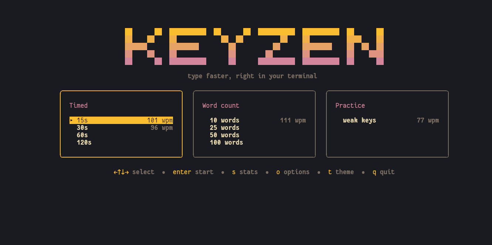
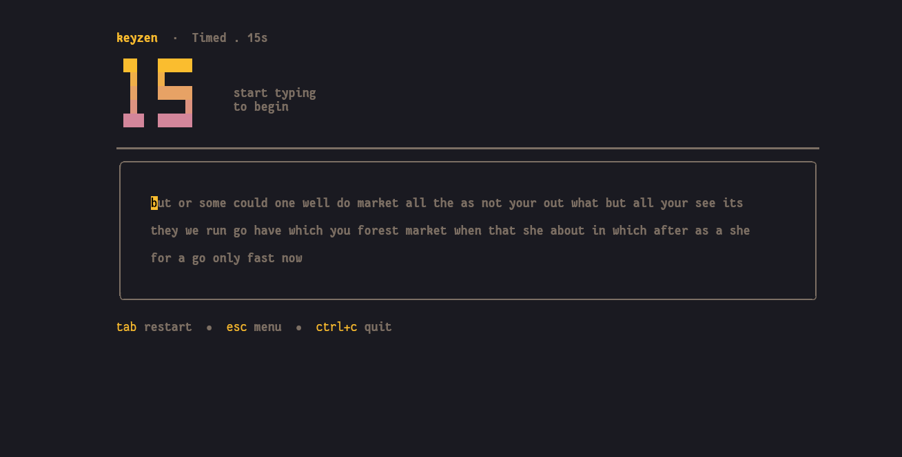
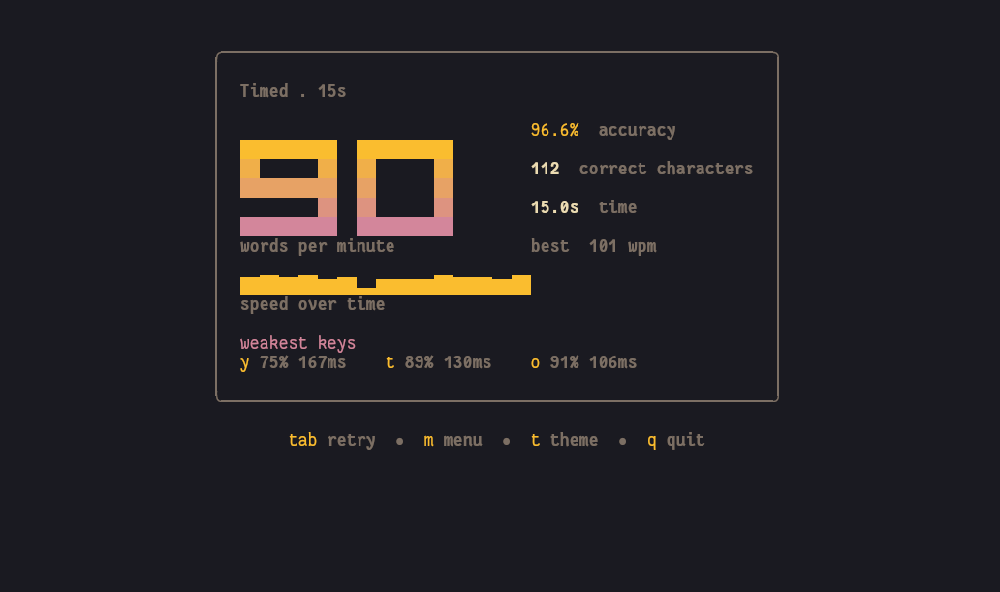
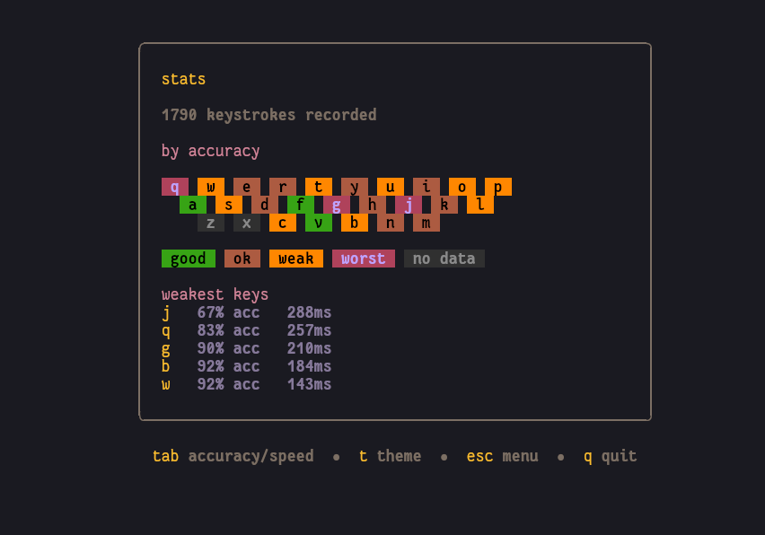

# keyzen

A fast, good-looking typing test for your terminal, built in Go with
[bubbletea](https://github.com/charmbracelet/bubbletea) and
[lipgloss](https://github.com/charmbracelet/lipgloss).

Pick a mode, type, and get your WPM, accuracy, speed over time and your
weakest keys. keyzen remembers your best scores and your per-key history, and
can build practice tests aimed at the keys you struggle with.


|                              |                            |
| ---------------------------- | -------------------------- |
|        |  |
|  |    |

## Features

- **Modes**
  - **Timed:** 15, 30, 60 or 120 seconds. The clock starts on your first keystroke.
  - **Word count:** 10, 25, 50 or 100 words.
  - **Practice:** words chosen to include the keys you're slowest or least accurate on.
- **Punctuation and numbers:** turn them on in settings for capitals, commas, sentence endings
  and numbers mixed into the text. Each combination keeps its own best score, so a punctuation
  run is never compared against a plain-words record.
- **Live feedback:** correct, wrong and pending characters are coloured as you type, with a
  giant countdown (it turns red in the last 5 seconds) and live WPM and accuracy.
- **Results screen:** big WPM, accuracy, a speed-over-time sparkline, the keys you actually
  got wrong, and your best score for that mode.
- **Stats screen:** a keyboard heatmap of your lifetime accuracy or speed per key.
- **Six themes:** midnight, nord, gruvbox, dracula, catppuccin. Press `t` to
  cycle; your choice is remembered.
- **Responsive layout:** adapts to your terminal size, from 80x24 up to very wide windows.
- **Single binary, no telemetry:** nothing leaves your machine. Scores and settings are small
  JSON files on disk.

## Install

With Go:

```bash
go install github.com/Varun0856/keyzen/cmd/keyzen@latest
```

Or download a prebuilt binary for Linux, macOS or Windows from the
[Releases](https://github.com/Varun0856/keyzen/releases) page.

Or build from source:

```bash
git clone https://github.com/Varun0856/keyzen
cd keyzen
go build -o keyzen ./cmd/keyzen
```

keyzen looks best in a terminal with truecolor and Unicode support (most modern terminals) and
at least 80x24 characters.

## Usage

```bash
keyzen                    # open the menu
keyzen -theme gruvbox     # start with a specific theme
keyzen --version          # print the version
keyzen -h                 # list options and themes
```

### Keys

| Screen                         | Key                                | Action                                    |
| ------------------------------ | ---------------------------------- | ----------------------------------------- |
| Menu                           | `←` `↑` `↓` `→` or `h` `j` `k` `l` | move                                      |
| Menu                           | `enter`                            | start the selected mode                   |
| Menu                           | `s`                                | open stats                                |
| Menu                           | `o`                                | open settings                             |
| Test                           | any letter                         | type (starts the clock in timed modes)    |
| Test                           | `backspace`                        | fix a mistake                             |
| Test                           | `tab`                              | restart with new words                    |
| Test                           | `esc`                              | back to the menu                          |
| Results                        | `tab` or `enter`                   | retry the same mode                       |
| Results                        | `m` or `esc`                       | back to the menu                          |
| Stats                          | `tab`                              | switch heatmap between accuracy and speed |
| Settings                       | `↑` `↓`                            | move                                      |
| Settings                       | `enter` or `space`                 | toggle the selected option                |
| Settings                       | `esc`                              | back to the menu                          |
| Menu, results, stats, settings | `t`                                | cycle theme                               |
| Anywhere                       | `ctrl+c`                           | quit                                      |

(`t` is not a shortcut during a test, since it's a letter you need to type.)

## How it's measured

- **WPM** counts only correct characters, with 5 characters = 1 word.
- **Accuracy** counts every keystroke, so fixing a mistake with backspace still counts
  against you.
- **Timing:** the clock starts at your first keystroke and stops when time runs out or you
  finish the text.
- **Heatmap:** a key needs at least 5 presses to be rated. Speed is judged against your own
  median key, so it adapts to how fast you type.
- **Weakest keys (results):** only keys you got wrong at least once in that test are listed,
  ranked by error rate, then by slowness.
- **Practice mode:** each word is weighted by the error rate and slowness of the letters in
  it, so weak keys appear more often. With too little data it falls back to normal random words.
- **Punctuation and numbers:** sentences end after 5 to 14 words with a full stop, question
  mark or exclamation mark, commas appear inside sentences, and about 1 word in 8 becomes a
  number of up to four digits.

## Your data

keyzen stores three small JSON files in a `keyzen` folder inside your OS config directory
(`~/.config/keyzen` on Linux):

| File          | Contents                                                     |
| ------------- | ------------------------------------------------------------ |
| `scores.json` | best result per mode and option set (e.g. `30s`, `30s+p+n`)  |
| `keys.json`   | lifetime per-key stats used by the heatmap and practice mode |
| `config.json` | your theme and the punctuation and numbers settings          |

Delete them any time to start fresh. Nothing is sent anywhere.

## Project layout

```
cmd/keyzen/        entry point, flags and version
internal/ui/       screens (menu, test, results, stats, settings), themes, block font, widgets
internal/mode/     test modes
internal/typing/   typing session, WPM/accuracy, per-key analysis (no UI code)
internal/words/    embedded word list, weighted picking, punctuation and number decoration
internal/storage/  scores, per-key stats and config persistence
```

The typing logic lives apart from the UI, so it's covered by plain table-driven tests. Anything
random (word picking, decoration) takes its random source as a parameter, so tests can control it.

## Development

```bash
go test ./...
go vet ./...
go run ./cmd/keyzen
```

CI runs gofmt, vet, tests with the race detector, and a build on every push.

Ideas and bug reports are welcome in the issues.

## Acknowledgements

Built on the excellent [Charm](https://charm.sh) libraries.

## License

MIT
